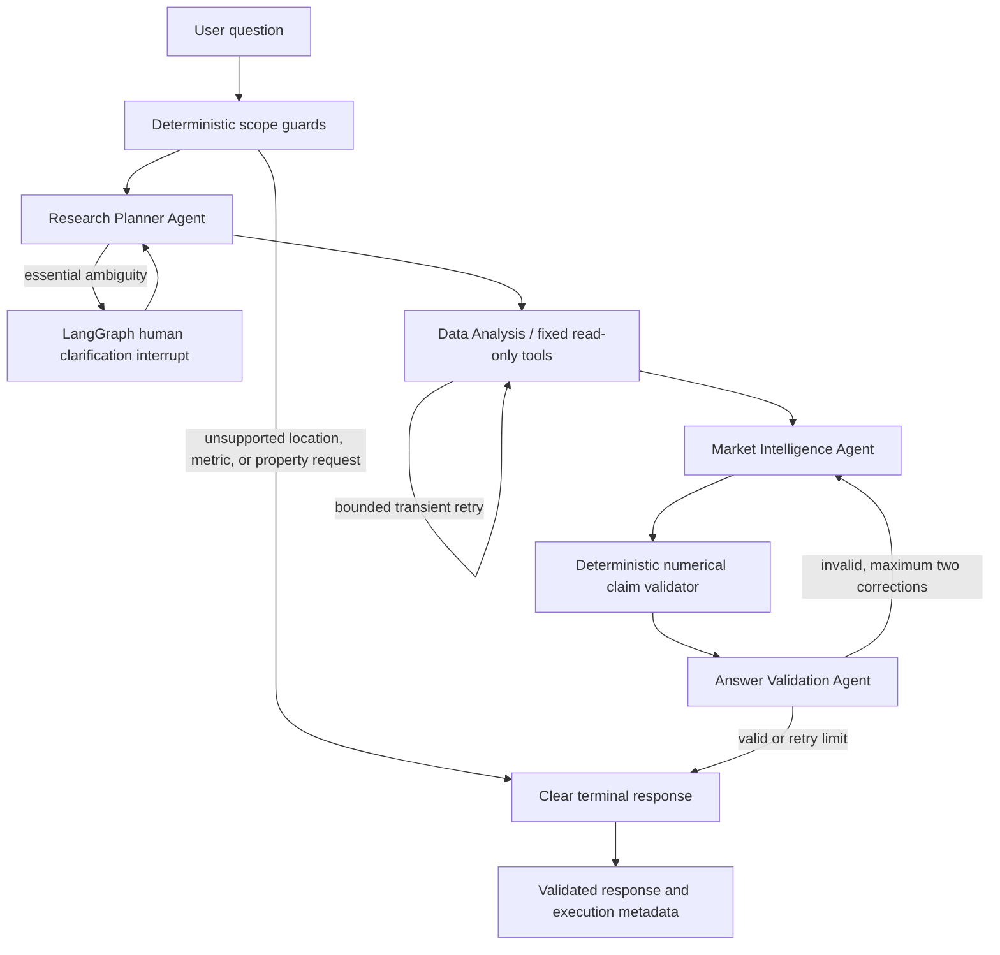

# EstateIQ

EstateIQ is a New Jersey real-estate market intelligence application built on Zillow Research data. It turns independently downloaded market datasets into a normalized SQLite database, deterministic analytics, interactive dashboards, and a stateful LangGraph research workflow.

Researching a housing market normally means reconciling home values, sale prices, inventory, sales activity, and market-speed data across files with different geographic coverage. EstateIQ performs that reconciliation locally, keeps city and MSA observations separate, and prevents its language model from inventing or calculating market statistics.

## Key features

- Reproducible ingestion of available Zillow Research CSV files without editing the originals.
- New Jersey filtering, wide-to-long normalization, validation, missing-value preservation, and indexed SQLite storage.
- City-level ZHVI history and appreciation calculations.
- MSA inventory, median sale price, sales count, days-to-pending, and heat-index analysis where source coverage exists.
- Four-stage LangGraph workflow with structured Pydantic outputs, fixed read-only tools, persistent conversation threads, validation retries, and human clarification interrupts.
- Deterministic numerical claim validation for metric, location, geography, date, unit, value, and direction.
- EstateIQ Streamlit interface with market overview, AI analyst chat, market comparisons, agent activity, and data-source transparency.
- Automated evaluation with versioned cases, SQLite reconciliation, an LLM judge, failure injection, trace IDs, and a human-review queue.

## Technology stack

| Technology | Role |
|---|---|
| Python, pandas | Ingestion, normalization, validation, and calculations |
| SQLite | Local normalized metric and conversation-checkpoint storage |
| LangChain, LangGraph | Structured calls, typed state, routing, persistence, and interrupts |
| Groq | Planner, interpretation, validation, and evaluation-judge inference |
| LangSmith | Optional tracing of graph nodes, model calls, tools, retries, and validation |
| Streamlit | Multi-page application and session-scoped chat state |
| Plotly | Interactive trend and comparison charts |
| pytest | Pipeline, agent, UI, validation, and evaluation regression tests |

## Multi-agent architecture



The Planner identifies canonical metrics, locations, geography, dates, and approved tools. Deterministic guards handle unsupported requests before an LLM is needed. The Data Analysis stage executes only predefined Python/SQL functions; model-generated SQL and arbitrary Python are not allowed. The Market Intelligence Agent explains returned observations and limitations. A Python claim binder and the Answer Validation Agent check the draft before completion.

LangGraph checkpoints preserve town, metric, and geography context for follow-up questions. Independent evaluation cases use isolated thread IDs; deliberate multi-turn cases share one thread.

## Data sources and coverage

EstateIQ uses files downloaded manually from [Zillow Research](https://www.zillow.com/research/data/). Zillow source files are not redistributed by this repository.

The current processed snapshot contains 161,883 rows with observations through **2026-09-30**:

| Metric | Unit | Current NJ geography | Observed range |
|---|---|---|---|
| Zillow Home Value Index (`zhvi`) | USD | 495 cities | 2000-01-31 to 2026-09-30 |
| For-sale inventory | homes | 4 MSAs | 2018-03-31 to 2026-09-30 |
| Market heat index | index | 4 MSAs | 2019-01-31 to 2026-09-30 |
| Median days to pending | days | 4 MSAs | 2018-03-31 to 2026-09-30 |
| Median sale price | USD | 4 MSAs | 2008-02-29 to 2026-09-30 |
| Sales count | sales | 4 MSAs | 2008-02-29 to 2026-09-30 |

ZHVI estimates typical home value; it is not an observed sale price. Median sale price is a separate transaction-derived series and is never silently substituted for ZHVI. County, state, and ZIP data and price-cut share are not present in the current source files. Missing observations remain SQL `NULL`, never zero.

Data remains subject to Zillow's definitions, revisions, geographic coverage, and publication schedule. EstateIQ is a research project, not an appraisal or investment recommendation.

## Installation and setup

Python 3.10 or newer is required.

```bash
git clone <your-repository-url>
cd nj-real-estate-intelligence-agent
python3 -m venv .venv
source .venv/bin/activate        # Windows: .venv\Scripts\activate
python -m pip install --upgrade pip
python -m pip install -r requirements.txt
cp .env.example .env
```

Add local credentials to `.env`:

```dotenv
GROQ_API_KEY=your-groq-key
GROQ_MODEL=openai/gpt-oss-20b
LANGSMITH_TRACING=true
LANGSMITH_API_KEY=your-langsmith-key
LANGSMITH_PROJECT=nj-real-estate-intelligence
LANGGRAPH_STRICT_MSGPACK=true
```

Real keys must never be committed. LangSmith variables are optional; Groq is required only for live agent calls and LLM-judged evaluation.

### Prepare the database

Download the desired Zillow Research CSVs and place them in `data/raw/`. The pipeline processes recognized files and reports missing optional files.

```bash
PYTHONPATH=src python -m real_estate.cli
```

This creates `data/processed/real_estate.db` and `data/processed/data_quality_report.json`. Alternative paths are available via `--raw-dir`, `--database`, and `--report`.

```bash
sqlite3 data/processed/real_estate.db ".tables"
sqlite3 -header -column data/processed/real_estate.db \
  "SELECT metric_name, geography_levels, date_start, date_end FROM datasets ORDER BY metric_name;"
```

### Run EstateIQ

```bash
source .venv/bin/activate
PYTHONPATH=src streamlit run streamlit_app.py
```

For a CLI conversation:

```bash
PYTHONPATH=src python -m real_estate.agent_cli \
  --thread-id demo-westfield \
  "Compare Westfield and Summit on latest home values and appreciation."
```

### Tests and evaluation

```bash
PYTHONPATH=src pytest -q

set -a
source .env
set +a
PYTHONPATH=src python -m real_estate.evaluation.runner \
  --run-id estateiq-eval-$(date +%Y%m%d-%H%M%S)
```

Use `--test-ids E01,E02` for a bounded subset and `--skip-llm-judge` when only deterministic checks are required. Provider-blocked or skipped judge results must not be reported as passes.

## Streamlit pages

- **Market overview:** source-backed KPIs, ZHVI and inventory trends, appreciation, freshness, and optional AI insight.
- **AI market analyst:** persistent chat, suggested questions, clarification handling, supporting evidence, and execution details.
- **Compare markets:** up to three supported locations with KPI tables and Plotly trends; unsupported metrics show **Not available**.
- **Agent activity & data:** actual graph stages, tools, validation, retries, Zillow dataset metadata, and architecture.

## Evaluation results

The final evidence-backed composite review contains all 15 original scenarios:

- 13 strict task successes
- 1 expected human clarification
- 1 successful transient-failure recovery
- 0 partial completions, graceful-error-only outcomes, or unrecovered failures
- 100% tool-selection accuracy (15/15)
- 100% numerical accuracy (11/11 applicable; four not applicable)
- 2/2 multi-turn cases passed
- Mean relevance and groundedness: 5.00/5 over 14 judged cases
- 48 automated regression tests passed

The original run passed 9/15. Repairs addressed multi-metric execution, geographic resolution, unsupported-input guards, genuine retry behavior, and claim validation. The final 15/15 figure is a transparent composite re-score of actual captured live responses, not a new atomic run. A new full run and planned three-repeat reliability measurement were blocked by the Groq token quota.

See [the final evaluation report](evaluation/final_evaluation_report.md), [audit](evaluation/evaluation_audit.md), and [repair summary](evaluation/repair_summary.md).

## Screenshots

Screenshots have not yet been committed. Before portfolio submission, capture:

1. Market overview with a supported town selected.
2. A Westfield-versus-Summit AI comparison and execution details.
3. Compare Markets trend chart and KPI table.
4. Agent Activity & Data Sources page.

Store approved images under `docs/images/`; no placeholder statistics or fabricated screenshots are included.

## Repository structure

```text
app_pages/             Streamlit pages
data/raw/              Local Zillow CSV inputs (ignored)
data/processed/        Generated SQLite and quality report (database ignored)
docs/                  Project, evaluation, demo, and submission documentation
evaluation/            Versioned cases and evidence-backed evaluation reports
src/real_estate/       Pipeline, queries, tools, LangGraph agents, UI services
tests/                 Pipeline, agent, validation, evaluation, and UI tests
streamlit_app.py       Streamlit entry point
```

## Future improvements

- Ingest compatible county, state, and ZIP datasets.
- Add a supported price-cut series.
- Run repeated live evaluations after provider quota resets and track variance.
- Complete independent human review of flagged semantic cases.
- Add CI for tests, secret scanning, and documentation link checks.
- Add deployment packaging and approved portfolio screenshots.

## Attribution and responsible use

Market data is attributed to Zillow Research. Review Zillow's current data terms before downloading, redistributing, or publishing derived outputs. EstateIQ does not scrape Zillow, value individual properties, or provide financial advice.
