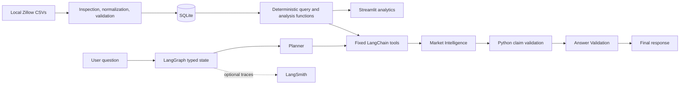

# EstateIQ project documentation

## 1. Executive summary

EstateIQ is a local-first New Jersey housing-market research application. It ingests independently downloaded Zillow Research files, validates and normalizes them into SQLite, exposes deterministic analytics, and uses a constrained LangGraph workflow to answer market questions. A Streamlit interface presents trends, comparisons, AI research, agent activity, and data provenance.

## 2. Problem statement

Housing-market research often requires manually reconciling files that use different metrics, date spans, geographic grains, and missing-value patterns. A language model can make that process easier to navigate, but only if calculations and data access remain deterministic and unsupported claims are rejected. EstateIQ combines those needs: reusable local analytics with a conversational research layer that cannot execute unrestricted SQL or Python.

## 3. Project objectives

- Preserve and normalize actual Zillow Research observations without inventing data.
- Keep city, MSA, and unsupported geography requests explicit.
- Provide reusable Python and SQL calculations for trends and appreciation.
- Support natural-language research and follow-up questions through typed agent state.
- Validate numerical claims against structured evidence.
- Make limitations, tool activity, retries, source files, and freshness visible.
- Measure reliability with repeatable automated evaluation.

## 4. Target users

- New Jersey buyers and sellers researching town-level value trends.
- Analysts comparing supported city and MSA markets.
- Portfolio reviewers evaluating data engineering, agent orchestration, and responsible AI controls.

EstateIQ is not intended for property appraisal, individual investment advice, or forecasting.

## 5. Data sources

The project uses CSV files manually downloaded from [Zillow Research](https://www.zillow.com/research/data/). Source files are read from `data/raw/` and are not modified or intended for repository redistribution.

| Metric | Unit | NJ coverage in current snapshot | Date range |
|---|---|---|---|
| ZHVI | USD | 495 cities | 2000-01-31–2026-09-30 |
| For-sale inventory | homes | 4 MSAs | 2018-03-31–2026-09-30 |
| Market heat index | index | 4 MSAs | 2019-01-31–2026-09-30 |
| Median days to pending | days | 4 MSAs | 2018-03-31–2026-09-30 |
| Median sale price | USD | 4 MSAs | 2008-02-29–2026-09-30 |
| Sales count | sales | 4 MSAs | 2008-02-29–2026-09-30 |

ZHVI estimates typical home value and is distinct from median sale price. The current database has no county, state, ZIP, or price-cut-share series. Missing source observations remain `NULL`.

## 6. System architecture

The `metrics` table stores one metric observation per region ID, geography, date, metric, and source. The `datasets` table records source-level schema, unit, coverage, date range, populated values, missingness, and validation metadata. Indexes support region, metric, geography, and date access.

## 7. Agent responsibilities

### Research Planner Agent

Returns a Pydantic `ResearchPlan` containing interpreted intent, locations, canonical metrics, geography, date bounds, approved tools, and clarification state. Deterministic guards intercept known unsupported requests before planning.

### Data Analysis Agent

This is a deterministic execution stage rather than an unrestricted coding agent. It resolves locations to Zillow region IDs and calls fixed read-only functions for trends, comparisons, appreciation, latest observations, and supported metadata.

### Market Intelligence Agent

Produces structured observations, interpretations, limitations, and a concise answer using only tool evidence. It cannot perform new calculations or classify a metric when interpretation thresholds are absent.

### Answer Validation Agent

Compares the draft to complete structured tool results. Before its LLM review, Python validation binds every numerical claim to metric, location, geography, date/range, unit, value, and direction. Unverified claims trigger correction.

## 8. Agent workflow

1. Receive a question and prior thread context.
2. Apply deterministic property-scope, location, metric, and statewide-ambiguity guards.
3. Create or clarify a structured research plan.
4. Resolve supported locations and Zillow region IDs.
5. Execute every requested metric independently through approved tools.
6. Retain successful results even when another requested metric is unavailable.
7. Generate a structured market explanation.
8. Run deterministic claim validation and the Answer Validation Agent.
9. Route an invalid draft back for at most two corrections.
10. Return the answer, limitations, and execution metadata.

## 9. Tool calling and state management

Tools expose metric/location discovery, city ZHVI history, market comparison, appreciation, and latest observations. They return source, metric, unit, geography, region IDs, date range, records, calculations, missingness, status, and an explanatory message.

`AgentState` stores the question, plan, analysis, report, validation, retries, context locations/metrics/geography, terminal answer, and errors. SQLite checkpoints persist production conversations; in-memory checkpoints support isolated tests. A stable thread ID enables follow-ups such as “How does that compare with Summit?”

## 10. Error handling and human-in-the-loop

- Missing metrics or geography return `unavailable`; no alternate metric is silently substituted.
- Unsupported property valuation terminates with an explicit market-level limitation.
- Duplicate place names can interrupt for an exact Zillow region ID.
- Broad statewide questions interrupt for location/geography and metric scope.
- Transient SQLite operational errors retry at most twice with bounded backoff.
- Permanent errors are not retried.
- Structured model calls use bounded retries; exhausted provider errors remain visible.
- Validation retries terminate after two corrections.

## 11. Evaluation methodology

The benchmark contains 15 versioned scenarios covering single-town research, multi-town and multi-metric comparison, appreciation, inventory, sales, market interpretation, follow-up context, missing history, unsupported inputs, ambiguity, transient tool failure, and property-scope refusal.

Deterministic checks verify tool, location, metric, behavior, workflow completion, SQLite reconciliation, numerical binding, dates, units, and direction. A separate structured LLM judge scores relevance, groundedness, clarity, and overstatement. Independent cases use isolated threads; E08 and E09 intentionally share one thread. Human review is prepared but not fabricated.

## 12. Evaluation results

The original run passed 9/15. After repairs, the final composite evidence set reports:

- 13 strict successes, one expected clarification, and one successful recovery.
- 15/15 tool-selection checks.
- 11/11 applicable numerical checks; four scenarios had no numerical claim.
- 2/2 multi-turn cases.
- Mean relevance and groundedness of 5.00/5 across 14 judged cases.
- 48 passing regression tests.

The final evidence is a re-score of actual captured responses and checkpoint state, not a new atomic run. The attempted final live run and planned three repetitions were blocked by the Groq token quota.

## 13. Significant failures

The audit identified dropped secondary metrics, location loss that caused broad MSA retrieval, unresolved unsupported-input interrupts, false statewide “no data” conclusions, property-scope ambiguity, error reporting mislabeled as recovery, and insufficient claim-to-context binding. The original evaluation also mixed targeted reruns under one run ID.

## 14. Repairs and iterations

- Executed every requested metric and retained partial availability.
- Resolved supported names to Zillow region IDs and rejected incompatible geography.
- Added deterministic unsupported-location, metric, statewide, and property guards.
- Implemented fail-once recovery and permanent-error classification.
- Separated strict success, partial completion, clarification, graceful error, recovery, failure, and excluded outcomes.
- Added deterministic claim binding and adversarial tests for metric, location, date, unit, missing-as-zero, and direction errors.
- Preserved individual source runs and documented composite final scoring.

## 15. Challenges and lessons learned

- Source coverage must govern tool selection; a polished answer cannot compensate for incompatible geographic grain.
- “Graceful error” and “recovered task” are different reliability outcomes.
- LLM-as-judge scoring is useful but cannot replace deterministic reconciliation.
- Streamlit reruns require session-scoped thread IDs and explicit action controls to avoid duplicate calls.
- Provider quotas and tracing availability are external operational dependencies and must remain visible in reports.

## 16. Limitations

- Only city ZHVI and four-MSA coverage are loaded.
- Price-cut share is unavailable.
- The app does not value individual properties or forecast prices.
- Human review is pending for three semantic cases.
- A fresh atomic final live run and three-repeat reliability rate remain unavailable because of provider quota.
- Zillow data may be revised after ingestion; freshness reflects the downloaded snapshot.

## 17. Future enhancements

- Ingest supported county, state, and ZIP datasets.
- Add price-cut data when an appropriate source is available.
- Run scheduled repeated evaluations and monitor variance.
- Complete independent human scoring and adjudication.
- Add CI, secret scanning, link checking, and deployment automation.

## Development prompts

The repository contains the actual runtime prompts in `src/real_estate/agent_prompts.py`. The complete AI coding conversation was not preserved as a versioned appendix, so this document does not reconstruct or invent it. Phase briefs that are intentionally retained may be added later as a separate prompts appendix after removing credentials and personal information.
